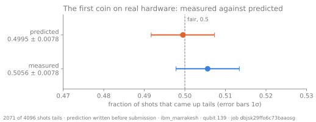
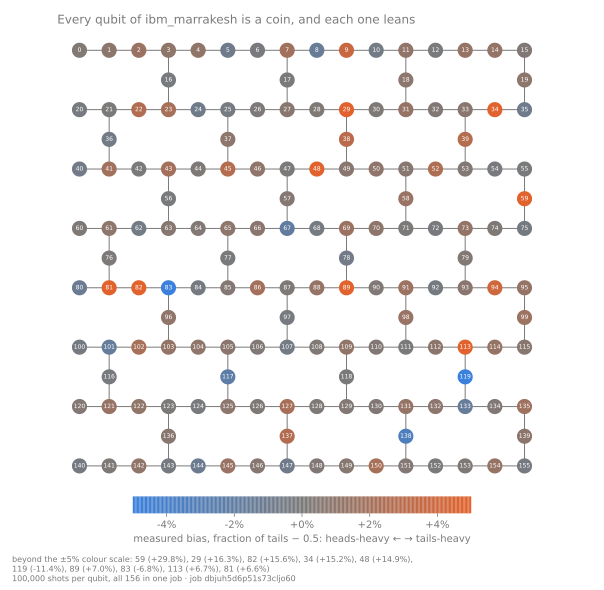
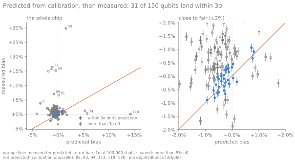

# Chapter 2: Predict the real coin

Chapter 1 built a coin whose every flip was decided by arithmetic before it happened. A
real qubit is not like that, but it is not ideal either. This chapter writes down, before
anything runs, how unfair each qubit of a real IBM quantum computer should be, and then
flips all 156 of them at once to find out.

The prediction fails. Most of this chapter is about how, and why that failure is the most
useful thing that could have happened.

## The first real flip

The first coin ever flipped on hardware for this project was qubit 139 of `ibm_marrakesh`,
a 156-qubit IBM Heron processor, 4,096 times. It came up tails 2,071 times: 50.56%.



The prediction was 49.95%. A dry run wrote it down six minutes before the job was
submitted (the copy written at submission is identical, and the archive's clock, to the
second, cannot tell it from the submission). The two agree, but
only because neither says much. With 4,096 flips the measured fraction wobbles by
±0.78% from shot noise alone, and the bias we expect from a real qubit is about half a
percent. To see it, we need about a hundred thousand flips. And since the qubits can all be
measured at once, flipping 156 coins costs the same as flipping one.

Before running that, we need a model of what "not ideal" means.

## A coin that forgets

Chapter 1 showed the quantum coin's party trick: apply H twice and it comes back heads,
every time, because the two paths to tails cancel. A statevector, a list of amplitudes,
is enough to describe that.

It is not enough to describe a real qubit. Real qubits leak information into their
surroundings, and then *nobody* knows their exact state, not even in principle. The
*density matrix* ρ can describe both a state known exactly and one known only up to
probabilities. For the tossed coin, which is known exactly, it is

```pycon
>>> from coin.circuit import Circuit
>>> from coin.sim import probabilities, simulate_density
>>> simulate_density(Circuit(1).h(0)).real.round(3)
array([[0.5, 0.5],
       [0.5, 0.5]])
```

The diagonal holds the probabilities of heads and tails. The off-diagonal entries hold the
*coherence*, the definite phase between them. Interference lives there.

Now let the coin forget its phase after every gate. This is *dephasing*, and the noise
model writes it as a channel:

```pycon
>>> from coin.noise import phase_damping
>>> forget = lambda op: (phase_damping(1.0, 0),)
>>> simulate_density(Circuit(1).h(0), forget).real.round(3)
array([[0.5, 0. ],
       [0. , 0.5]])
```

Measured once, the two coins are indistinguishable: both are fifty-fifty. But toss each one
twice:

```pycon
>>> twice = Circuit(1).h(0).h(0).measure(0, 0)
>>> probabilities(twice)
{'0': 1.0}
>>> probabilities(twice, forget)
{'0': 0.5, '1': 0.5}
```

The coin that forgot can no longer interfere. It has become an ordinary coin. Real noise
is a milder version of this, and every source of it is a *channel* that maps one density
matrix to another. The simulator applies one after each gate. The model is built from
these channels.

## What the calibration says

IBM regularly measures every qubit and publishes the results. Three numbers
matter for a coin:

- **T1**, how long a qubit holds |1⟩ before it relaxes to |0⟩. Tails decays to heads.
- **T2**, how long it holds a phase. This is the forgetting above.
- **Readout error**, how often the measurement reports the wrong answer, given separately
  for each answer.

Here is qubit 10 of `ibm_marrakesh`, from the calibration archived with the run this chapter
is about:

```pycon
>>> from coin.archive import load_run
>>> from coin.noise import model_from_calibration
>>> run = load_run("data/runs/2026-11-02-dbjuh5d6p51s73cljo60")
>>> q10 = model_from_calibration(run.calibration).qubits[10]
>>> round(q10.t1_ns / 1000), round(q10.t2_ns / 1000)
(196, 127)
>>> q10.readout
Readout(p1_given_0=0.0029296875, p0_given_1=0.0166015625)
```

T1 is 196 µs and T2 is 127 µs. The coin's one physical gate, `sx`, takes 36 ns, so the
qubit barely has time to decay during it.

The readout is less forgiving. A heads is misread as tails 0.29% of the time, but a tails
is misread as heads 1.66% of the time. The asymmetry is physical: reading a qubit takes
2.7 µs, seventy-five times longer than the gate, and a |1⟩ can relax to |0⟩ while it is
being read. Readout acts on the outcome, not on ρ, so it is applied to the probabilities
afterwards:

```pycon
>>> from coin.noise import apply_readout
>>> apply_readout({"0": 0.5, "1": 0.5}, {0: q10.readout})
{'0': 0.5068359375, '1': 0.4931640625}
```

So a perfect coin, read by an imperfect detector, comes up tails 49.32% of the time.

## Which error matters

Every qubit has all of these errors at once. Spike 0018 switched them on one at a time, on
every qubit with complete calibration, to see which ones bias the coin. Its script runs on
any archived run. On the first run's calibration:

```console
$ uv run python analysis/dominant_errors.py data/runs/2026-11-01-dbjsk29ffo6c73baaosg
qubits analysed: 151 of 156
incomplete calibration (skipped): {82: ['T2'], 94: ['T1', 'T2'], 130: ['T1', 'T2']}
T2 > 2·T1 (skipped): [20, 83]
no init_error (preparation row only): [23, 26, 113, 119, 121, 135]
source                                                      median   max |·|
readout asymmetry                                         -0.00439   0.26172
T1/T2 during sx                                           -0.00011   0.00330
gate error (depolarizing)                                 +0.00000   0.00000
preparation error                                         +0.00000   0.00000
T1 over the measurement window (double counts readout)    -0.00814   0.19487
```

Readout asymmetry dominates: it biases a typical qubit by −0.44%, forty times more than
decay during the gate.

Two rows are exactly zero:
- **Preparation error.** A qubit that starts partly in |1⟩ is a mixture of heads and tails,
  and H turns both halves into a fair coin.
- **Gate error.** IBM reports it as one number per gate, which the model treats as
  *depolarizing* noise: a random scramble that pulls the state toward the centre without
  favouring either side.

Remember that second zero.

The last row is the alternative the spike rejected. Adding decay over the 2.7 µs readout
window on top of the readout error counts the same decay twice, because the readout
calibration already contains it. The chip map records both predictions, so the hardware can
say which it agrees with.

## The prediction, written first

`coin run chip-map --backend ibm_marrakesh --shots 100000` did the following:
1. It fetched the calibration, which IBM had updated 11 minutes earlier.
2. It predicted every qubit.
3. It wrote the predictions to disk, 2.3 seconds before submitting the job.

It left six qubits out, each with a stated reason:
- three have missing T1 or T2;
- one reports a T2 longer than physics allows (T2 can never exceed 2·T1);
- one has a failed `sx` calibration;
- one misreads tails as heads more often than not.

That left 150 predictions. The median predicted bias was −0.45%, heads-heavy, as the
readout asymmetry says it should be.

The job flipped all 156 qubits 100,000 times each and cost 29 seconds of QPU time.

## The chip map



Every qubit is a coin, and every one leans. Most lean by a percent or two. A few lean by
far more: qubit 59 came up tails 79.8% of the time.

## The prediction failed

`coin compare` reads the archived run and holds it against its own prediction:

```console
$ coin compare data/runs/2026-11-02-dbjuh5d6p51s73cljo60
run          ibm_marrakesh, job dbjuh5d6p51s73cljo60, 156 qubits × 100,000 shots
prediction   written 2.3 s before submission; 150 qubits predicted, 6 excluded
                               model   alternative
within 3σ                         31            16
median bias, predicted        -0.45%        -1.24%
median bias, measured         +0.45%
correlation with measured      -0.00         +0.01
closer to the measurement        129            21
coherent     131 of 150 within 3σ if each sx error may be coherent (median bound ±2.54%)
drift        8 of 156 qubits changed by more than 3σ between the run's halves (0.4 expected if they held still)
largest misses      predicted    measured    off by
   59                  +1.55%     +29.79%   +178.7σ
   29                  -1.14%     +16.34%   +110.6σ
   48                  -1.91%     +14.90%   +106.4σ
   34                  -0.45%     +15.17%    +98.8σ
  118                 +14.25%      +0.03%    -93.8σ
```

At 100,000 shots, 1σ is about 0.16%. If the model were right, nearly all 150 qubits
would land within 3σ of their predictions. Only 31 did.

The failure has three parts:
- **No skill.** Across qubits, the correlation between predicted and measured bias is
  zero. Knowing a qubit's prediction tells you nothing about how it will lean.
- **The wrong direction.** The typical qubit leaned *tails* by 0.45%, almost exactly the
  opposite of the predicted heads lean of 0.45%.
- **The alternative is worse.** It is closer than the model on only 21 qubits, so spike
  0018 was right to reject it. That is the only part of the prediction to survive.



The model is not wrong everywhere. Qubit 10 was predicted at 49.31% tails and measured at
49.46%, 1σ away. But a model that is right for a fifth of the chip, without any way to say
in advance *which* fifth, is not a model of the chip.

A result like this should first be suspected of being a bug. A coin whose bias comes out
mirrored, with zero correlation, is what you would see if the bits were read in the wrong
order or the wrong way up. So the comparison was repeated with the bit order reversed, with
heads and tails swapped, and with both. None of them correlates with the prediction (the
best gives r = 0.13). The bookkeeping is not the problem. The physics is.

## Where the model went wrong

### The zero that was not a zero

The gate error that spike 0018 found to be harmless contributes nothing only if it is
depolarizing. IBM measures it by *randomized benchmarking*, which reports how far, on
average, a gate falls short of perfect. It does not say how. A random scramble and a
consistent over-rotation can fall short by the same amount.

They do very different things to a coin. Suppose `sx` over-rotates by a small angle ε.
Then the coin's state is tipped off the equator, and P(tails) moves by sin(ε)/2.
Randomized benchmarking would report this rotation as an error of roughly (2/3)·sin²(ε/2). Run
that backwards, and the published gate error caps how far a purely coherent error could
push the coin:

```pycon
>>> from coin.noise import coherent_bias_bound
>>> q10.gates["sx"].error
0.00018779466622193103
>>> f"{coherent_bias_bound(q10.gates['sx'].error):.2%}"
'1.68%'
```

So a gate error of 0.019% leaves room for a bias of ±1.68%: more than twice the 0.68% that
readout gives this qubit, and nearly four times the chip's median readout effect. Across the chip, the median bound is ±2.54%. If any part of each
qubit's `sx` error is coherent, and nothing in the calibration says it is not, the
calibration *cannot* predict this coin to better than a couple of percent. Allow for it,
shrunk by each qubit's readout on the way to the measured fraction, and 131 of 150 qubits
land within 3σ.

That is less of a rescue than it sounds. A model that allows ±2.5% on every qubit predicts
almost nothing. What it shows is where the information is missing. The published numbers
average away the one property of the gate that decides which way this coin leans.

### Qubits nothing explains

Nineteen qubits miss by more than even that allows. Two of them show the limits of the
calibration from opposite sides.

**Qubit 59** came up tails 79.8% of the time. Its readout errors are 10.1% and 6.9%, and
no readout that bad can turn a fair coin into an 80% one. Starting from the wrong state
cannot explain an 80% coin either, because H makes a mixture fair (that is the preparation
row in the table above), and its gate error bounds a coherent miss at 2.5%. Something that
none of its published numbers described was happening to qubit 59.

The next calibration said what. Spike 0069 measured every qubit's readout directly a few
hours later, and fetched the calibration published in between:

```pycon
>>> from coin.readout import measured, published_readout
>>> zero = load_run("data/runs/2026-11-02-dbk2a81kdqps7391ka9g")
>>> one = load_run("data/runs/2026-11-02-dbk2khgnceqs73al2ojg")
>>> later_0, _ = published_readout(zero.calibration, 0)
>>> later_1, _ = published_readout(one.calibration, 1)
>>> round(later_0[59], 3), round(later_1[59], 3)
(0.747, 0.188)
>>> round(0.5 * (1 - later_1[59]) + 0.5 * later_0[59], 3)
0.78
>>> direct = measured(zero, one)[59]
>>> round(direct.p1_given_0, 3), round(direct.p0_given_1, 3)
(0.066, 0.069)
```

For a while qubit 59's measurement read heads as tails three times in four: a coin at 78.0%,
close to the 79.8% it gave. The calibration recorded that after the chip map ran. By the
time of spike 0069 the readout had recovered (6.6% and 6.9%), and the coin was fair again.
The readout broke and mended itself between calibrations.

**Qubit 118** is the mirror image. Its calibration says 47.2% of heads are misread as
tails, which predicts a coin at 64.3% tails. It came up 50.0%, as fair as any qubit on the
chip. The readout calibration is itself a measurement, made at a different time and under
different conditions. For this qubit, it did not describe the readout our job got.

### The coins moved

The drift line of the comparison splits each qubit's 100,000 flips into the first and
second half, about twelve seconds each, and asks whether the two halves differ by more than
shot noise allows. A qubit that held still would pass 3σ by chance about once in 370 tries,
so across 156 qubits we would expect 0.4 to. Eight did.

Most of the chip held still, then. A handful of qubits did not, and they are not subtle.
Qubit 34 came up tails 62.1% of the time in the first half and 68.2% in the second, a
change of twenty standard deviations. Three of the five worst-predicted qubits (59, 29 and
34) are among the eight that moved, and so is the sixth, qubit 89. The other two, 48 and
118, held still, so drift is part of the story and not all of it.

A calibration is a snapshot. Some of these coins change within seconds. No calibration
taken before the run, however recent, could have described them exactly.

## What this means

Spike 0069 tested these explanations. Three jobs ran on every qubit in one session:
prepare |0⟩ and measure, prepare |1⟩ and measure, and the coin again. The last two ran
within two minutes of each other; the first queued for twenty minutes, and the archive
does not say exactly when in that time it ran. The first two measure each
qubit's readout as a job actually sees it, and the published readout matched poorly
(qubit 59 above is the extreme case).

Undoing the measured readout recovers what the coin did before it was read:

```pycon
>>> import statistics
>>> from coin.chipmap import tails_by_qubit
>>> second = load_run("data/runs/2026-11-02-dbk2l21kdqps7391l420")
>>> tails = tails_by_qubit(second)
>>> before = [
...     (tails[q] / second.shots - r.p1_given_0) / (1 - r.p1_given_0 - r.p0_given_1) - 0.5
...     for q, r in measured(zero, one).items()
...     if 1 - r.p1_given_0 - r.p0_given_1 > 0.05
... ]
>>> len(before), f"{statistics.median(before):+.2%}"
(155, '+0.63%')
```

Before it is measured, the typical coin on this second chip map leans *tails* by 0.63%: a
chip-wide lean in the state preparation, within what a coherent `sx` error of the published
size allows. The readout then pulls toward heads. The second map's prediction missed the
same way the first did (−0.40% predicted, +0.17% measured): both took their lean almost
entirely from the published readout, as the table of dominant errors showed, and neither
has a term for a lean in the state itself. That is the likeliest reason the first
prediction had the sign wrong. The first map has no readout measured alongside it, so it
cannot be checked directly.

For the question this project asks, the result matters. Chapter 0 distrusted random numbers
that come from a process you have to take on faith. This chapter took the manufacturer's
own description of its device and found that it does not predict how the device's coins
lean, or even which way. The bias is real, it is different on every qubit, and the largest
parts of it come and go.

So the way forward cannot depend on knowing the bias. Chapter 3 does not try to predict
it. It removes it, with a procedure that makes a biased coin fair without knowing the bias,
provided the flips are independent and the bias holds steady from one flip to the next. The
drift above says not to assume that. Checking it is the next thing to measure.
