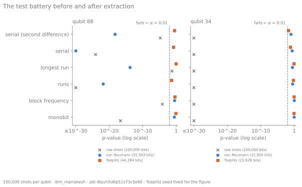

# Chapter 3: Make it fair

Chapter 2 tried to predict how unfair each qubit's coin would be, and failed. A second chip
map, 4.7 hours after the first, shows why prediction is the wrong goal:

```pycon
>>> import statistics
>>> from coin.archive import load_run
>>> from coin.chipmap import tails_by_qubit
>>> first = load_run("data/runs/2026-11-02-dbjuh5d6p51s73cljo60")
>>> second = load_run("data/runs/2026-11-02-dbk2l21kdqps7391l420")
>>> a, b = tails_by_qubit(first), tails_by_qubit(second)
>>> x = [a[q] / first.shots - 0.5 for q in range(156)]
>>> y = [b[q] / second.shots - 0.5 for q in range(156)]
>>> round(statistics.correlation(x, y, method="ranked"), 2)
0.31
>>> round(statistics.correlation(x, y), 2)
-0.05
>>> calm = [q for q in range(156) if abs(x[q]) < 0.05 and abs(y[q]) < 0.05]
>>> len(calm), round(statistics.correlation([x[q] for q in calm], [y[q] for q in calm]), 2)
(144, 0.24)
```

Part of each qubit's lean persists. Ranked by bias, the two maps agree moderately (+0.31),
and so do the 144 qubits that stayed within 5% of fair in both (+0.24). But the large leans
do not persist. Qubits that came up 65–80% tails in the first map were near fair in the
second, and others took their place. The plain correlation, dominated by those few, is
−0.05.

Spike 0069 traced the largest of them to the measurement. For a while, qubit 59's readout
read heads as tails three times in four. The calibration published afterwards recorded it;
hours later the readout had recovered, and the coin came up 49.8% tails.

So a qubit's bias is partly a property of the qubit and partly an event. Neither part can be
corrected for, because neither is known in advance: chapter 2 showed the published
calibration does not predict the first, and the excursions come and go within hours.

So this chapter stops predicting the bias and removes it, without ever knowing what it is.

## The harvest

The coin ran 100,000 times on qubit 104 of `ibm_marrakesh`, the qubit whose published
readout errs least. Its prediction, written first as always, was 49.80% tails.

```pycon
>>> from coin.archive import load_run
>>> from coin.harvest import shots_of
>>> harvest = load_run("data/runs/2026-11-02-dbk2ldpffo6c73ban1n0")
>>> shots = shots_of(harvest)
>>> len(shots), int(shots.sum())
(100000, 51161)
```

51,161 tails is 51.16%, seven standard deviations from fair, and the prediction missed again.

## Correcting the estimate is not correcting the coin

Part of that lean is the measurement. Spike 0069 measured every qubit's readout directly:
prepare |0⟩ and read it, prepare |1⟩ and read it. Undoing qubit 104's readout recovers a
better estimate of what the coin did before it was read:

```pycon
>>> from coin.mitigate import mitigate
>>> from coin.readout import measured
>>> readout = measured(
...     load_run("data/runs/2026-11-02-dbk2a81kdqps7391ka9g"),
...     load_run("data/runs/2026-11-02-dbk2khgnceqs73al2ojg"),
... )[104]
>>> round(readout.p1_given_0, 5), round(readout.p0_given_1, 5)
(0.00515, 0.00785)
>>> round(mitigate({"0": 0.48839, "1": 0.51161}, {0: readout})["1"], 4)
0.5131
```

So the coin itself leans 1.3% toward tails, and the readout slightly hides it.

That is *mitigation*, and it is the wrong tool for this job. It corrects a distribution: our
estimate of the bias. It cannot touch a single flip. A flip that came up tails is tails; no
arithmetic afterwards can say whether that one was misread. Every one of the 100,000 bits
is still exactly as biased as it was.

## Von Neumann's trick

In 1951 John von Neumann described how to make a fair coin from a biased one without
knowing the bias. Flip twice. If the flips differ, keep the first: 01 gives 0, 10 gives 1.
If they match, throw both away and flip again.

The argument takes one line. If every flip is tails with the same probability p,
independently, then 01 and 10 are equally likely, each p(1 − p). Whatever p is, the result
is fair.

```pycon
>>> import numpy as np
>>> from coin.extract import von_neumann
>>> coin = (np.random.default_rng(1).random(100_000) < 0.7).astype(np.uint8)
>>> round(float(coin.mean()), 4)
0.6989
>>> fair = von_neumann(coin)
>>> len(fair), round(float(fair.mean()), 4)
(20871, 0.5014)
```

A 70% coin goes in, and a 50% coin comes out. The price is throughput: on average, p(1 − p)
bits per flip, which is 0.21 here and never more than a quarter. Peres's iteration
(`coin.extract.peres`) recovers most of what is thrown away; on qubit 104's shots it keeps
95,379 bits where plain von Neumann keeps 25,129.

## The assumption

Read the argument again: *independently*, and *the same probability p*. Von Neumann's trick
is guaranteed to be exactly fair when the flips do not influence each other and the bias
holds still between the two flips of a pair. Without that, its output may still come out
fair, as qubit 88 shows below, but nothing guarantees it.

Spike 0028 tested that on the chip map's 100,000 shots of each of 156 qubits
(`analysis/independence.py`):
- **151 qubits passed.** None of their 15,100 autocorrelations at lags 1–100 went beyond
  4σ.
- **Five failed, each in a recognisable way.**
  - Qubit 34 switched between about 52% and 72% tails, like a defect flipping between two
    states.
  - Qubit 88 carried a periodic disturbance, a sharp line at 0.489 cycles per shot.

Qubit 88 shows what goes wrong. Von Neumann's output from its shots is fair: 25,503 bits
that pass a test of their frequency with p = 0.27. But they are not independent. The
disturbance tilts each pair one way, then the other, as its phase drifts against the
pairing. The tilts average out, but the bits remember them.



"Fair" and "independent" are different claims. An extractor that only delivers the first
gives false confidence: its output looks right on the measure people check first.

## The battery

How does one check bits at all? `coin.battery` implements five tests from NIST's SP 800-22,
written from the standard and checked against its worked examples to six digits. Each asks
one question a random sequence should answer unremarkably:
- **monobit:** as many ones as zeros?
- **block frequency:** about half ones in every block?
- **runs:** the right number of runs of equal bits?
- **longest run:** the longest run of ones as long as chance gives?
- **serial:** every overlapping pattern of a few bits equally common?

Each returns a p-value: how often a truly random sequence would look at least this unusual.
By NIST's convention, below 0.01 is a failure. The serial test returns two (one for pairs
against single bits, one for triples against pairs), so the battery reports six p-values.

On qubit 104's raw shots, monobit gives p = 2.1 × 10⁻¹³. The runs test reports 0, which
means "not applied": the frequency is already too far off for it to be meaningful.
Von Neumann's output passes all six p-values.

## Hashing instead of pairing

The alternative needs one number instead of an assumption. *Min-entropy* is a property of
the source: if no strategy can guess its next bit with probability better than 2^−h, the
source carries h bits of min-entropy per bit. A fair coin has 1; a 70% coin has 0.51; a
coin that copies its last flip has nearly 0, however fair it looks.

The *leftover hash lemma* turns min-entropy into fair bits. Multiply n input bits that
carry k bits of min-entropy by a random binary matrix (here a Toeplitz matrix, built from a
seed), and the first k − 2·log₂(1/ε) bits of the product are within ε of uniform, however
the input bits depend on each other. The seed must be uniform, but it does not have to be
secret.

`coin.extract.min_entropy` estimates h by trying to guess the bits:
- by their bias, overall and in the worst stretch;
- by the bits before them;
- by their position in a cycle.

Two independent reviews tried to fool it, with sources a qubit could plausibly produce. One
of them fooled it by up to 1.77 times, so extraction spends only half the estimate.

Half covers what those reviews found, not everything. A third review built a source in
which each bit is the parity of the bits 17 and 20 before it, flipped 5% of the time. It
carries 0.074 bits of min-entropy per bit, and the estimate says about 0.91: none of the
guessers looks at two earlier bits at once, and no margin covers a twelvefold miss. The
estimate sees bias, drift, switching, cycles and short memory, and is blind beyond them.

For qubit 104 the estimate was 0.884 bits per shot, and 0.442 was spent. The run's
`extraction.json` records that, along with the seed.

```pycon
>>> import json
>>> from pathlib import Path
>>> from coin.extract import toeplitz
>>> record = json.loads(Path("data/runs/2026-11-02-dbk2ldpffo6c73ban1n0/extraction.json").read_text())
>>> round(record["estimate"], 4), round(record["entropy_per_bit"], 4), record["bits"]
(0.8842, 0.4421, 44144)
>>> packed = np.frombuffer(bytes.fromhex(record["seed"]), dtype=np.uint8)
>>> seed = np.unpackbits(packed)[: record["seed_bits"]]
>>> bits = toeplitz(shots, seed, record["bits"])
>>> int(bits.sum()), len(bits) - int(bits.sum())
(22173, 21971)
```

44,144 bits, within ε = 2.3 × 10⁻¹⁰ of uniform if the estimate holds, and 50.23% tails,
well within the wobble of a fair coin. They pass all six p-values; the smallest is 0.21.

These were the bits in this project's first entropy pool, and they are already spent:
`coin flip` handed out exactly those 21,971 heads and 22,173 tails. That order matters. The
archived shots and the recorded seed determine every bit, which is what lets you check the
flips above. Published before they were spent, the same two files would have let anyone
predict them. So the harvest's run was committed only after its batch was gone: spend,
then publish.

## π

Here is the catch.

```pycon
>>> from coin.battery import battery, passes, pi_bits
>>> passes(battery(pi_bits(1_000_000)))
True
```

The first million binary digits of π pass every test in the battery. Nothing is less random
than π: every digit was fixed before anyone looked, and anyone can compute the next one.
`min_entropy` is fooled too: on 100,000 of π's bits it estimates 0.91 bits per bit, the
same as it gives a fair coin of that length.

That is chapter 0's point, now made executable. A statistical test can show that a
sequence is *not* random. It can never show that it is. Every number in this chapter
rests on an assumption about the source: that its structure is within reach of our
guessers, and that a qubit is not a cleverly disguised π. The extractor's guarantee is
only as good as that assumption.

So, if no test of the output can prove randomness, what can?

The answer turns out to need a second qubit, and a result that bothered Einstein. Two
entangled coins can agree in a way that no pre-written list of outcomes could reproduce.
Chapter 4 builds that pair. Chapter 5 uses it to certify randomness while trusting far less
about the device, and lists the assumptions this experiment cannot remove.
