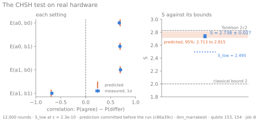

# Chapter 5: The proof

Chapter 3 showed that no test of a sequence can prove it random: π passes them all.
Chapter 4 showed that two coins agreeing proves nothing: glued coins agree too. Both failed
for the same reason. A list written in advance could have produced what they looked at.

So the question becomes whether anything can be measured that no list written in advance
could produce. In 1964 John Bell showed there is. This chapter measures it on real hardware,
with the prediction made in public first, and then says exactly how far the result reaches.

## A game no list can win

Alice and Bob sit in separate rooms. Each round, Alice is handed a random bit x and Bob a
random bit y, and each answers with a bit, a and b. They win the round if their answers
agree, unless both were handed 1, when they must differ. They may plan anything beforehand,
but they cannot talk once the round starts.

A plan is a list: what Alice answers to 0 and to 1, and the same for Bob. There are sixteen
plans, so they can all be tried:

```pycon
>>> from itertools import product
>>> def wins(alice, bob):
...     return sum((alice[x] ^ bob[y]) == (x & y) for x, y in product((0, 1), repeat=2))
>>> plans = list(product((0, 1), repeat=2))
>>> scores = [wins(alice, bob) for alice, bob in product(plans, plans)]
>>> max(scores), scores.count(3), scores.count(4)
(3, 8, 0)
```

No plan wins all four input pairs. The best win three of them, so a plan wins at most 75%
of rounds when the inputs are random. Randomising among plans cannot help, because a
mixture of plans does no better than its best plan. This is the *CHSH game*, after Clauser,
Horne, Shimony and Holt, and the 75% is a fact about lists.

## What the Bell pair does instead

Give Alice and Bob one qubit each of chapter 4's Bell pair. Each reads the qubit along an
axis chosen by the input: Alice along 0 or π/2, Bob along π/4 or −π/4. Their answers
correlate by the cosine of the angle between their axes:

```pycon
>>> import math
>>> from coin import chsh
>>> from coin.compile import lower
>>> from coin.sim import probabilities
>>> e = {
...     (i, j): chsh.correlation(probabilities(lower(chsh.circuit(a, b))))
...     for i, a in enumerate(chsh.ALICE)
...     for j, b in enumerate(chsh.BOB)
... }
>>> {setting: round(value, 4) for setting, value in e.items()}
{(0, 0): 0.7071, (0, 1): 0.7071, (1, 0): 0.7071, (1, 1): -0.7071}
>>> round(chsh.s_value(e), 4), round(math.cos(math.pi / 8) ** 2, 4)
(2.8284, 0.8536)
```

Three settings agree more often than not, and the fourth disagrees more often than not,
which is just what the game asks. The sum S = E₀₀ + E₀₁ + E₁₀ − E₁₁ is 2√2, and the
win rate is w = 1/2 + S/8 = cos²(π/8), or 85.36%. Any plan keeps S ≤ 2, which is the 75%
again. Quantum mechanics goes no higher than 2√2, Tsirelson's bound.

Here is the shape of the argument, and it is the point of the whole essay. If the qubits'
answers had been fixed before the inputs arrived, that would be a plan, and plans cannot
beat 75%. So, provided the two sides really cannot talk and really do not know the inputs in
advance, a win rate above 75% means the answers were not fixed beforehand. That is a
statement about how the bits came to exist, which no test of the bits alone could make.
Those two provisos are doing real work, and the end of this chapter comes back to them.

## Measuring it

Each round needs its own setting, and all four must interleave through the job, or drift
would touch one correlation and not another. A job per round would spend the whole allowance
on overhead. So the four settings are compiled onto one skeleton,
differing only in four `rz` angles, which are free on hardware, and one job binds a row of
angles per round.

The pair was chosen, and S predicted, from readout measured in the same session, because
chapter 4 showed what published readout is worth. The prediction was then committed, with
every round's setting and the calibration it was made from, in
[`c86a39c`](https://github.com/oddurs/fairest-coin/commit/c86a39cfcfb6a715e661121228b50fdf9df87b75):

```pycon
>>> from coin.archive import load_run
>>> run = load_run("data/runs/2026-11-05-dbmfqed8ft8s738upl80")
>>> prediction = run.prediction.values
>>> prediction["pair"], round(prediction["s"], 3)
([153, 154], 2.765)
>>> [round(bound, 3) for bound in prediction["interval"]]
[2.713, 2.815]
>>> prediction["committed_as"][:7], prediction["prediction_file"]
('c86a39c', 'data/predictions/2026-11-05T215257-chsh-ibm_marrakesh.json.gz')
```

The interval carries the uncertainty of what the prediction rests on: the measured readout,
a factor of two either way on the `cz` error, for which IBM publishes no error bar, and the
scatter of 12,000 rounds. `coin run chsh --submit` refuses a prediction git does not hold
unchanged, and that commit is an ancestor of the [run's
commit](https://github.com/oddurs/fairest-coin/commit/6146f58) on `main`. Anyone can check
the order with `git merge-base --is-ancestor`.

## The result

```console
$ coin compare data/runs/2026-11-05-dbmfqed8ft8s738upl80
pair         153-154, 12,000 rounds
S            2.738 ± 0.027 measured, 2.765 predicted, z = -1.0
S_low        2.495 at ε = 2.3e-10 (classical bound 2, Tsirelson 2.828)
interval     [2.713, 2.815] predicted: S fell inside it
first half   S = 2.775 ± 0.037
second half  S = 2.701 ± 0.038
predicted in commit c86a39cfcfb6a715e661121228b50fdf9df87b75
E(0,0)       +0.674 measured, +0.690 predicted, 2,935 rounds
E(0,1)       +0.687 measured, +0.690 predicted, 3,054 rounds
E(1,0)       +0.699 measured, +0.692 predicted, 3,053 rounds
E(1,1)       -0.678 measured, -0.692 predicted, 2,958 rounds
```



After a chip map that missed, a harvest that missed and a Bell pair that missed, this one
landed: S fell inside the interval written down beforehand. The pair won 84.23% of its 12,000
rounds, where no plan wins more than 75%.

The standard error describes how S would scatter over repeated runs. It is not the number
that matters. S_low is: a bound from the win count alone, by Hoeffding's inequality, which
assumes nothing about how the rounds are distributed except that they are independent. It
says that if S were really 2.495 or less, a win count this high would come up less than once
in 4.3 billion runs. That is what ε = 2⁻³² means here, and at 2.495 the bound stands half a
unit above what any plan can reach.

## The coin chooses

One circularity remains. Those settings came from the operating system's generator, and a
certificate that leans on a pseudo-random generator is the thing chapter 0 distrusted. So
the next run took its settings from the coin: chapter 3's pool, refilled by a fresh harvest of
44,920 bits from qubit 8. Each round spends two of them, one for each side, so the coin's
own bits choose how the next coins are read.

The prediction was committed before the run, as before, in
[`f2a8dc0`](https://github.com/oddurs/fairest-coin/commit/f2a8dc01a421b2c52c8dcdc32b99272e57f70062),
and it names the batch that supplied the settings:

```pycon
>>> from pathlib import Path
>>> from coin import bell
>>> planned = bell.load_prediction(
...     Path("data/predictions/2026-11-07T030927-chsh-ibm_marrakesh.json.gz")
... )
>>> values = planned.submission.prediction.values
>>> planned.pair, round(planned.s, 3), [round(bound, 3) for bound in planned.interval]
((153, 154), 2.755, [2.715, 2.796])
>>> values["settings_source"]["pool"]
[{'batch': '20261107T030744114512-dbn986c4148s7390hohg', 'bits': 44000, 'offset': 0}]
```

The 22,000 rounds gave S = 2.761 ± 0.020, inside the interval again, and S_low = 2.582.

A violation vouches for more than the word "quantum". Pironio and colleagues showed in 2010
how much unpredictability a given S implies: a round's two outcome bits carry at least
1 − log₂(1 + √(2 − S²/4)) bits of min-entropy, without any model of what is inside the
device, given the assumptions the last section of this chapter lists.

```pycon
>>> from coin.certify import certified_rate
>>> [round(certified_rate(s), 3) for s in (2.0, 2.5, 2.582, 2.7, 2 * math.sqrt(2))]
[0.0, 0.268, 0.343, 0.493, 1.0]
```

So chapter 3's estimate, which no test could back, can be replaced by a number a measurement
backs. `coin certify` hashes the run's outcome bits at exactly that rate, taken at S_low and
never at S, into a certified batch. A run with S_low at or below 2 credits nothing.

| | bits |
|---|---:|
| Setting bits spent, 2 per round | 44,000 |
| Certified bits made, at 0.343 per round | 7,475 |
| Net | −36,525 |

The loop is honest about this: it spends about six times what it makes. Each round consumes two
fresh bits and certifies a third of one, so this does not expand randomness, and with uniform
settings it cannot. What comes out is a different kind of bit, not more of them. Here is the
first one spent:

```text
TAILS
  ibm_marrakesh · qubits 153, 154 · job dbn9fldt7fqc73aj5l5g · harvested 2026-11-07
  run 2026-11-07-dbn9fldt7fqc73aj5l5g · bit 1 of 7,475 in batch 20261107T031643078560-dbn9fldt7fqc73aj5l5g
  Bell-certified: S = 2.761, S_low = 2.582 at ε = 2.3e-10 on qubits 153, 154; 0.343 bits a round, hashed with ε = 2.3e-10; settings from 20261107T030744114512-dbn986c4148s7390hohg
```

That run is not in the archive yet, and neither is the harvest behind it. Their shots
determine bits still unspent, so, as in chapter 3, they are published only when their batches
are empty. Until then these figures are the record of them; once spent, `coin publish` adds
them, and every flip can be recomputed.

## What this does not prove

S_low is a theorem about a game, and it holds only if the game was really played. These are
the assumptions under it, in the order they matter.

**One chip.** The game needs two sides that cannot talk. Qubits 153 and 154 are neighbours on
one chip, joined by the coupler that entangled them and read out by one control system.
Nothing here stops one side's setting or outcome reaching the other. A real Bell test puts the two sides far enough apart that light
cannot cross between the choice and the answer. This one does not, so a sufficiently
contrived device could fake the violation. This is the *locality loophole*, and this
experiment leaves it wide open.

**Settings in the job before it runs.** The game needs inputs the devices cannot know in
advance. Every setting here was in the job before the first round, and in a public git
commit before that. A device that read its job ahead could plan accordingly. This is the
*freedom-of-choice* assumption, and it is assumed, not tested.

**Independent rounds.** Hoeffding's inequality needs rounds that do not depend on each other,
and the certified rate also wants them alike. The runs' own evidence is not quite clean. The
first run's halves give 2.775 and 2.701, and the second's 2.794 and 2.729: 1.4 and 1.7
standard errors apart, the same way round both times, about 2.2 together. That is not
established, but it may be drift within a job. Spike 0028 found qubits that change within
seconds, and spike 0069 found readout that breaks and mends between calibrations. Halves can
show drift. They cannot show its absence.

**The hardware's word.** The outcomes are what IBM's system reported. Every round is counted,
so no selection of rounds flatters the result, which closes the *detection loophole* that
troubled early experiments. But the whole chain from qubit to file is trusted.

**No expansion.** Every round spends two setting bits and certifies well under one, so this
produces less randomness than it consumes. It changes what the bits rest on, not how many
there are. Protocols that come out ahead exist, and this is not one of them.

So what has been shown is narrower than "this coin is random". On the assumption that the
chip's two qubits do not secretly coordinate and that the job's settings were not used
against us, the bits were not fixed in advance, and here is how many of them that vouches
for. A loophole-free experiment needs what this project does not have: two labs, a fast
enough setting source, and a detection chain nobody has to trust. The [epilogue] takes up
what that would really take.

[epilogue]: ../../README.md#the-chapters
